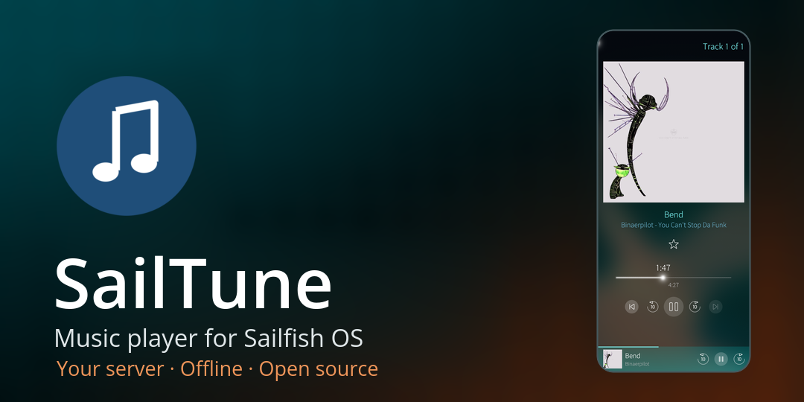
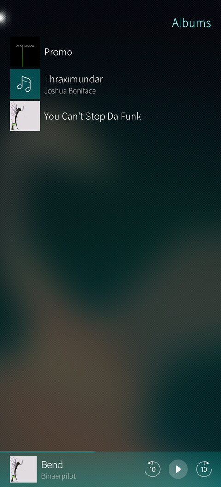
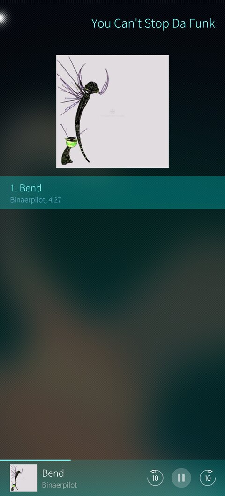
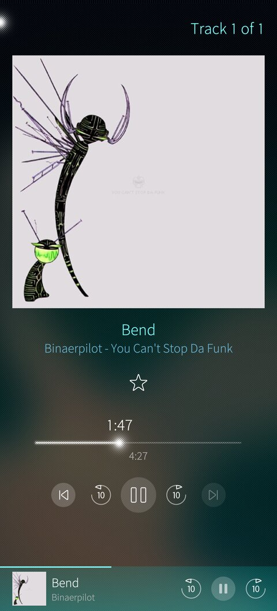

# SailTune



A music player for Sailfish OS for the music on the phone and on your
own server. It streams while the server is reachable, at home or over a
VPN, and plays albums and playlists downloaded to the phone without any
network.

**Status:** ready for its first release in the Jolla Store, 0.5.2. The
plan is in [PLAN.md](PLAN.md), the security review in
[docs/security-review-2026-10.md](docs/security-review-2026-10.md), the
privacy policy in [PRIVACY.md](PRIVACY.md) and how to report a security
problem in [SECURITY.md](SECURITY.md).

<p align="center">
  
  
  
</p>

The screenshots show Jellyfin's public demo server; the covers are
Binärpilot's "You Can't Stop Da Funk" (CC BY-NC-ND 2.5) and "Promo"
(CC BY-NC-ND 2.0).

## Features

- The music on the phone, with its album art, and the music on Jellyfin
  servers; login with password or Quick Connect.
- Downloads of albums, playlists and favorites for offline play, with
  their covers, on the phone or the memory card; all albums at once;
  downloads resume after a lost connection or a restart.
- Player with lock screen and cover controls that resumes the exact
  position after the app was closed.
- Favorites and plays synced with the server, also when made offline;
  adding to a playlist and creating one on the server.

## Building

You need the [Sailfish SDK](https://docs.sailfishos.org/Tools/Sailfish_SDK/)
(tested with 3.13) and its aarch64 build target.

```sh
sfdk config --global --push target SailfishOS-5.1.0.11-aarch64
sfdk build
```

The RPM lands in `RPMS/`. To run the Harbour validator on it:

```sh
sfdk -c no-fix-version build
sfdk check RPMS/harbour-sailtune-*.rpm
```

## AI disclosure

- **AI-assisted development.** I write SailTune's code together with
  Claude Code, an AI coding agent. I write much of it myself; Claude
  Code contributes code, suggested fixes, refactoring, tests and
  documentation, always under my direction.
- **Reviewed and owned by me.** I review every change before it is
  committed. I decide what ships and I am responsible for it.
- **Verified, not trusted.** Generated code gets no special trust. Risky
  platform behavior is tried in a spike on the phone before the app
  relies on it, the app is tested against a real Jellyfin server, and
  device results are stated only when they were measured on a Jolla
  phone.

## License

[MIT](LICENSE).

SailTune is an independent project and not affiliated with Jellyfin or
Jolla.
